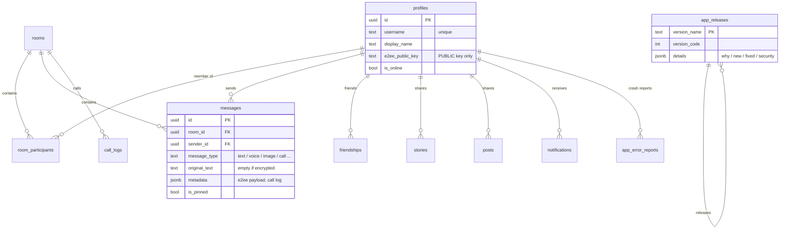
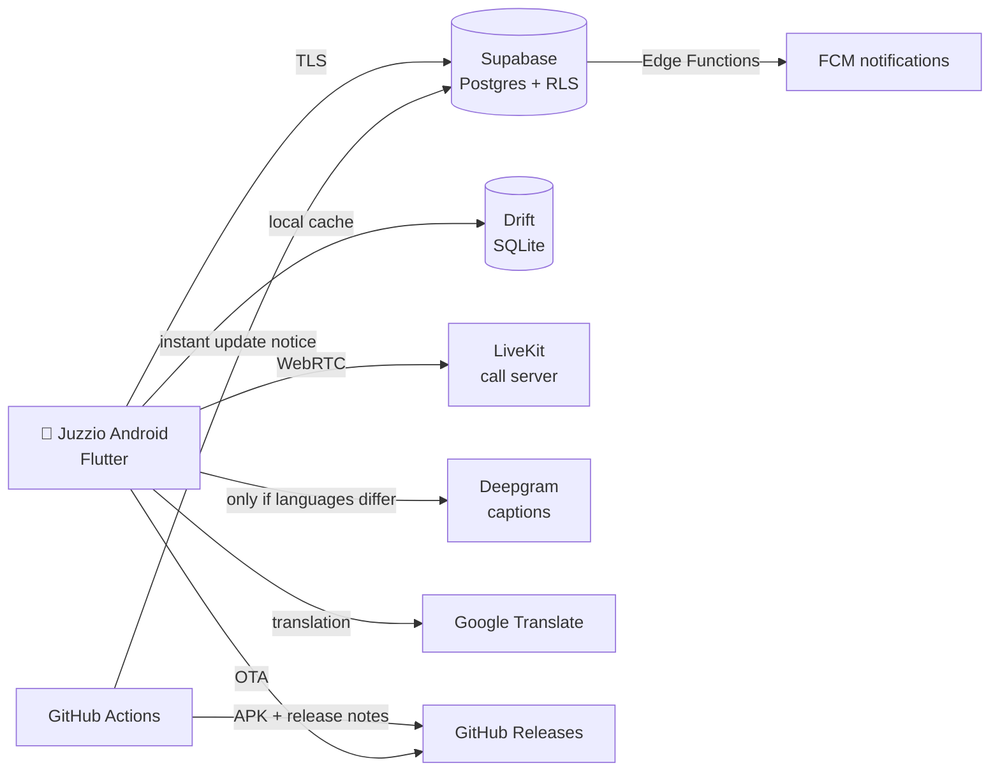

<div align="center">

# 🌍 Juzzio — Live-Translated Voice & Video Calls, End-to-End Encrypted Messaging

**Talk to the world in your own language.** Juzzio brings **live voice call translation**, **live video call translation**, **translated messaging**, stories, posts and 4-person conference calls together in one modern Android app with a Liquid Glass (glassmorphism) design.

[](https://github.com/engiincr/Juzzio-Chat/releases/latest)
[](https://github.com/engiincr/Juzzio-Chat/releases/latest/download/Juzzio-latest.apk)
[](#-beta--early-access)
[](#-privacy--security)
[](#-privacy--security)
[](LICENSE)

🇬🇧 English · 🇹🇷 Türkçe · 🇩🇪 Deutsch · and translation into 220+ languages

🌐 **Website:** [engiincr.github.io/Juzzio-Chat](https://engiincr.github.io/Juzzio-Chat/) · **Juzzio** — live translation video call app, translated voice calls, end-to-end encrypted messenger

</div>

<!-- JUZZIO_DYNAMIC_TITLE_START -->
### 🚀 Latest update: **v1.0.0 — Juzzio Space: New Design & Instant Messaging**
<!-- JUZZIO_DYNAMIC_TITLE_END -->

<!-- JUZZIO_VERIFIED_APK_START -->
| Version | APK | Size | SHA-256 | Built |
| :-- | :-- | :-- | :-- | :-- |
| v1.0.0 (+100) | Waiting for the GitHub Actions build | – | – | – |
<!-- JUZZIO_VERIFIED_APK_END -->

---

## 📑 Contents

- [🆕 Today's updates (November 9, 2026)](#-todays-updates-november-9-2026)
- [✨ What can you do?](#-what-can-you-do)
- [🔐 Privacy & security](#-privacy--security)
- [📦 Download & install](#-download--install)
- [🗂️ Release history](#️-release-history)
- [🗄️ Database schema](#️-database-schema)
- [🏗️ Architecture](#️-architecture)
- [🛠️ Developer setup](#️-developer-setup)
- [🧪 BETA / Early access](#-beta--early-access)
- [⚖️ License & legal](#️-license--legal)

---

## 🆕 Today's updates (November 9, 2026)

Seven releases shipped today — **v0.9.4, v0.9.5, v0.9.6, v0.9.7, v0.9.8, v0.9.9 and v1.0.0**. Every update below is also shown inside the app on the first launch after updating ("What's new?"), with the same sections and emojis. Full notes: [release-notes.md](release-notes.md) · [GitHub Releases](https://github.com/engiincr/Juzzio-Chat/releases).

<details open>
<summary><b>v1.0.0 — Juzzio Space: New Design & Instant Messaging</b></summary>

### 🎯 Why did this update come?
Juzzio moves to the "Juzzio Space" interface designed in Figma: deep theme gradients, frosted glass cards and a glowing accent in every theme. In the same update messages send without waiting, location/link/poll experiences were rebuilt, shifts can be planned by date range and admin logs became readable.

### ✨ What's new?
- 🎨 Juzzio Space design: "Your space · Juzzio." header, search with a ⌘K shortcut, story rings, Inbox · Messages, filter pills with counters, glass chat cards and a floating glass bottom bar
- 🌈 All 16 themes share the same design language; accent, background depth and glass opacity come from the selected theme (Emerald is the default for new users)
- ⚡ Messages send instantly: the bubble appears right away, translation runs in the background and shows up under the message when ready (in end-to-end encrypted chats the translation is added encrypted too)
- 📍 Shared locations appear as a card with a map preview and open in Google Maps on Android, Apple Maps on iOS, or Google Maps
- 🔗 Links, e-mail addresses and phone numbers in messages, bios, posts and comments are tappable and open in the default browser/app
- 🪪 Profile and admin panel use the Juzzio Space layout too: large header, square avatar with a glowing ring, glass counter tiles, accent primary button, capsule tabs and glass stat cards
- 📊 New poll card: options with share bars, percentages, winner highlight and a live status chip
- 📅 Date ranges in the shift planner: pick start–end days and hours (overnight shifts included), filter weekdays/weekends, share with a group and post a plan summary automatically
- 🐣 When petted, the chick twirls to the right like a princess, winks and flirts; the chick badge in chats does the same animation
- 👑 New chick customizations: princess tiara, flower crown, wizard hat, star glasses, princess tutu, pearl necklace, ballet shoes, Castle/Space/Sakura scenes
- 🧾 Admin logs are readable sentences in the admin's language: who did what, to whom and when (no raw codes or IDs)

### 🛠️ What was fixed?
- Cloth pull-to-refresh fixed on mobile: no more conflict with Android's stretch overscroll or iOS bouncing, and short lists can be pulled too
- Removed the GPU blur artifact on the hand shadow (rectangular smudge/flicker); a soft radial shadow is used instead
- Chat ⋯ menu cleaned up: no emojis, icons and an opaque (readable) background, destructive actions separated in red
- Menus, bottom sheets and dialogs are now nearly opaque — text stays readable

### 🔒 Security
- The link opener only allows http/https/mailto/tel/geo (javascript:, file: etc. are rejected)
- Background translation keeps end-to-end encryption: in encrypted chats the translation is attached as a separate encrypted payload

</details>

<details>
<summary><b>v0.9.9 — Cloth Refresh: Pixel-Faithful 3D Revision</b></summary>

### 🎯 Why did this update come?
The v0.9.8 cloth refresh preview was compared frame by frame with the reference video and 11 visual/timing deviations were found. This update fixes the 3D hand, fabric folds, notch layering and page sync to match all 11 points exactly.

### ✨ What's new?
- ⚫ The Dynamic Island is pure black (#000000) in both themes and always on the top layer; the hand is masked at the island's bottom edge, emerges from it and disappears back into it
- 👀 On the first pull (0–35 px) only the 4 chubby fingertips and nails peek out from under the island; the hand and wrist come down as you keep pulling
- 🖐️ A shorter, chubbier 3D clay arm (wrist ≈ 55% of the island width), glossy 3D nails on every finger including the thumb, knuckle creases and a warm matte peach skin (#F2C2B3 / #DF9F8E / #F9DCD3)
- 🕰️ During the pendulum the root stays fixed at the island while the arm and wrist bend like a flexible bone; at the +25° peak the fingers fan out, then close again on the way back (9 separate 3D poses)
- ✊ The fist clearly shows the 4 curled fingers' knuckles, vertical shadow grooves between them and the thumb clenched underneath
- 🦋 When the fist closes, butterfly-wing pinch folds curl up toward the island on its left and right; the bottom stays smooth
- 🧵 On the yank, 6 curved, asymmetric 3D drapery pleats cover the search icon, location title and avatar like a semi-transparent sheet and reach down to "Popular Food"
- 📏 The content moves 140–155 px down while pulling and swinging, so the hand swings in clean empty space without touching any text or icon
- 🔒 The page stays locked at the fully pulled position until the fist grabs the fabric; only during the yank does it rise, attached to the fist's lower edge at the same speed as the hand
- 🧺 In the last 250 ms the folds stretch upward and flatten, and the page settles with no jitter

### 🛠️ What was fixed?
- Removed the black/dark grey "sunburst" lines in light mode: valleys are only silver grey (#DFE2E8–#C8CDD6), ridges pure white
- Removed the white haze around the fist in dark mode: valleys #07080B, ridges #222630
- The hand no longer paints over the notch; the grey notch in dark mode is fixed
- Removed the rigid single-sprite arm rotation
- Fixed the page jumping up early while the fist was still closing
- The APK build failed on a dependency conflict (file_picker <12 needs win32 ^5, flutter_secure_storage ^11 needs win32 ^6); file_picker was upgraded to ^13 and the encrypted key store was left untouched

</details>

<details>
<summary><b>v0.9.8 — 3D Clay Hand Cloth Refresh</b></summary>

### 🎯 Why did this update come?
The 2D cloth effect in v0.9.7 did not match the reference animation. Pull-to-refresh was rewritten from scratch as a 5-phase 3D experience.

### ✨ What's new?
- 🖐️ **3D clay hand & arm** (real 3D render: subsurface scattering, ambient occlusion, matte sheen) emerging from the Dynamic Island, with a soft drop shadow that follows the light
- ⬇️ **Pull** → 🕰️ **pendulum swing** while loading (−15°, +25°, center) → ✊ **fist grabs the screen** → 🧵 **yank up with deep 3D drapery folds** while the page springs back → 🧺 **folds smooth out** in ~250 ms
- 🎨 Fabric shading follows your theme (white/silver in light mode, frosted ridges + matte shadows in dark/glass themes)
- ⚡ One RepaintBoundary, no page rebuilds, 60/120 fps on every main page

### 🛠️ What was fixed?
- The 2D drop drawing from v0.9.7 did not match the reference video and was removed

</details>

<details>
<summary><b>v0.9.7 — Cloth Refresh, Instant Launch & Elite Glass UI</b></summary>

### 🎯 Why did this update come?
Chats now open instantly from a local SQLite cache, scroll jitter is gone, calls save battery and keep live translation visible in picture-in-picture, and the whole interface moves to a more modern, fluid and elite Liquid Glass experience.

### ✨ What's new?
- ⚡ **Instant launch:** the chat list and messages appear on the first frame from a **Drift (SQLite)** local cache (stale-while-revalidate); syncing never blocks you
- 🧵 **Cloth pull-to-refresh** on every main page (rebuilt in 3D in v0.9.8)
- 💬 Chats always open at the **latest message**; older messages load automatically as you scroll up, with no jitter
- 🔴 Modern **pill-shaped unread badge** in your theme colors with a springy animation
- 🫧 **Shimmer skeleton loaders** instead of empty grey screens
- 🌗 **Circular reveal** animation when switching dark/light mode
- 🔔 **Stacked notifications:** in-app cards slide over each other; grouped in the Android notification shade too
- 🎨 **4 new glass themes** — Aurora Borealis, Frosted Pearl, Midnight Sapphire, Nordic Frost (16 total) — plus a subtle frosted texture
- 👤 Avatars and online dots now follow your theme colors instead of grey
- 📺 **Live translation stays visible in PiP** (picture-in-picture)
- 🔋 **Call power profile:** 360p·15 fps in the background/PiP or on weak networks; no more full-screen redraw every second
- 🧹 **Smart media cache cleanup** with an admin-controlled size limit and maximum age

### 🛠️ What was fixed?
- Chats opening scrolled up, jitter while scrolling up and the list jumping to the bottom
- "Tap to start chatting" showing on chats that already have messages at launch
- The call timer redrawing the whole call screen every second (battery and heat)

### 🔒 Security & privacy
- The strictest `.gitignore` yet: env files, signing keys, certificates, local databases and build outputs can never be committed
- The secret scanner now also blocks forbidden tracked files and webhook secrets
- The local SQLite cache is per account, deleted on sign-out, and keeps E2EE messages encrypted on disk

</details>

<details>
<summary><b>v0.9.6 — God Mode Admin, Eye Comfort & Pinned Messages</b></summary>

- 🛡️ **Admin → System (god mode):** system health, crash center, storage maintenance and orphan media scan, multi-account detection, per-user AI quota, voice/video limits, minimum supported build, brute-force thresholds, legal export, sign everyone out
- 👁️ **Eye Comfort:** amber blue-light filter — manual, scheduled (e.g. 20:00–07:00) or sunset to sunrise, with intensity control
- 📌 **Pinned messages** in groups and 1:1 chats (up to 5, shown at the top)
- ✏️ Edits show an **"Edited"** label, are re-translated and notify the other side with **"(Edited)"**
- 🐞 **Automatic crash reporting** with masked stack traces (can be turned off)
- 📶 On mobile data, calls offer a **"Data saver" prompt with an "Apply" button** instead of switching on automatically
- 🎙️ Call badges when the other side's microphone or camera is off
- 🔐 Voice messages, videos and story replies in 1:1 chats are now **end-to-end encrypted**

</details>

<details>
<summary><b>v0.9.5 — Watch Party, Safety Check & View-Once Media</b></summary>

- 🎬 **Watch party:** .mp4/.m3u8 videos play at the same second for everyone
- 🆘 **Safety check (SOS):** alert with location if arrival time passes, no movement, or battery drops to 5%
- 1️⃣ **View-once photos:** deleted permanently after opening; screenshots blocked
- ❓ **Anonymous question box**, 🏅 **badges & streaks**, 🔐 **safety number** (QR + 60 digits)
- 📞 "Ringing…" / "Calling…" status with a ringback tone; polls close automatically
- 🛠️ Fixed the admin panel "invalid setting" error when choosing a theme

</details>

<details>
<summary><b>v0.9.4 — Documents, Events & Security Audit</b></summary>

- 📎 **Attachment menu:** documents (E2EE in 1:1), gallery, video, location, contact card, poll, event, schedule
- 🗓️ **Group events** with RSVP and reminders; **shift planner** with a shared team calendar
- 🐥 **Chick wardrobe:** hats, glasses, outfits, themes
- ⏰ Warning when the device clock is more than 2 minutes off
- 🔒 Fixes from a live database security & performance audit

</details>

---

## ✨ What can you do?

| | Feature | Description |
| :-: | :-- | :-- |
| 🎙️ | **Live-translated voice calls** | When someone speaking a different language joins, speech becomes live captions in your language. No translation panel between people who speak the same language. |
| 🎥 | **Live-translated video calls** | A caption strip that never covers faces, a glass control rail, front/back camera, natural beauty mode; captions keep flowing in PiP. |
| 👥 | **Conferences (4 people)** | Add people to an ongoing call, join group calls later, manage participants. |
| 💬 | **Translated messaging** | Every message appears in the other person's language; "See original" is always one tap away. |
| 🔒 | **End-to-end encryption** | 1:1 messages, photos, videos, voice messages, documents and locations are encrypted on the device (X25519 + ML-KEM-768, AES-256-GCM). |
| ⚡ | **Instant & offline** | Drift (SQLite) local cache: chats open on the first frame and stay readable without internet. |
| 🎬 | **Watch party** | Watch videos together, perfectly in sync. |
| 🆘 | **Safety check** | Share your live location with a chat until you arrive safely. |
| 📌 | **Pinned messages & events** | Pin important messages; plan group events with RSVP. |
| 👁️ | **Eye Comfort** | Amber blue-light filter, scheduled or from sunset to sunrise. |
| 🎨 | **16 glass themes** | Liquid Glass design family + Theme Studio for your own palette; day / night / system. |
| 🧩 | **6 Android widgets** | Chat, quick actions, unread, camera, last call, recent chats — match your theme and language. |
| 🐣 | **Chick game** | Feed the egg in the straw nest with a friend; it shakes, hatches and grows. |
| 🆕 | **Transparent updates** | Why each release came, what's new, what was fixed and security changes — inside the app and on GitHub. |

---

## 🔐 Privacy & security

> Details: **[PRIVACY.md](PRIVACY.md)** · **[TERMS.md](TERMS.md)** · legally binding Turkish versions in [docs/legal/tr](docs/legal/tr). The same texts are in the app under **Settings → Help → Privacy & legal**.

- ❌ **Personal data is never sold**; no advertising or analytics/tracking libraries.
- ❌ **No card or bank details**; the app contains no payment code.
- ❌ **Camera and microphone are never used without permission**; calls are not recorded.
- ❌ **Contacts and SMS are never read**; location is read only for actions you start (send location, safety check, Eye Comfort sunset mode) and never in the background.
- ✅ **1:1 chats are end-to-end encrypted with post-quantum hybrid keys**; the server and administrators cannot see the content.
- ✅ Row-level security (RLS): everyone only sees chats they are a member of.
- ✅ No secret keys in the repository; an **automatic secret scan** (`scripts/check_secrets.py`) and a strict `.gitignore` guard every push.
- ✅ Updates come only from the official GitHub release; an APK with a different signature cannot be installed over the app.
- ℹ️ Limits, stated openly: group messages and group media are not end-to-end encrypted yet; while automatic translation is on, text is sent to the translation service.

🛡️ Found a vulnerability? Please report it privately to **engiincr@pm.me** before publishing. Fixed issues are announced in the **🔒 Security & privacy** section of the release notes.

---

## 📦 Download & install

1. 📥 Download [**Juzzio-latest.apk**](https://github.com/engiincr/Juzzio-Chat/releases/latest/download/Juzzio-latest.apk).
2. 📲 If Android asks for the "install unknown apps" permission, allow it for this install.
3. 🔄 Future updates arrive inside the app: you are notified as soon as a release is published, and **Snooze** keeps you undisturbed for the time you choose.

---

## 🗂️ Release history

<details>
<summary><b>v0.9.0 – v0.9.3 — Security hardening, offline mode, PiP calls, notification translation</b></summary>

- Fail-closed E2EE, encrypted photos and scheduled messages, Security Center with devices and security events
- WhatsApp-style offline reading and media cache; calls continue in a mini window / PiP
- Notifications translated into your language and answerable from the notification
</details>

<details>
<summary><b>v0.8.0 — Post-quantum encryption, encrypted Google Drive backup, soft glass UI</b></summary>

- 🔐 X25519 + **ML-KEM-768 (NIST FIPS 203)** hybrid key exchange, HKDF-SHA256, AES-256-GCM; protection against "harvest now, decrypt later"
- 🔁 New session key every 50 messages / 24 hours, new identity key every 30 days
- ☁️ Encrypted Google Drive backup (Argon2id + AES-256-GCM)
- ✍️ Update notice verification signed with **ML-DSA-65 (FIPS 204)**
</details>

<details>
<summary><b>v0.7.0 — Transparency, end-to-end encryption, ringtones, 6 widgets</b></summary>

- End-to-end encryption for 1:1 text messages, Juzzio ringtones and per-contact tones
- Contact info and call detail pages, music on profiles and stories, close friends
- 6 Android widgets, "What's new in version X?" window, proprietary license
</details>

<details>
<summary><b>v0.2.0 – v0.6.1 — Glassmorphism design, moderation, profiles, studio</b></summary>

- Aurora + frosted glass design, content moderation and penalty ladder, admin panel
- Instagram-style profiles, friends and message requests, content studio, in-app OTA updates
- Every chat in its own room (RLS); secrets removed from the repository
</details>

All releases: [GitHub Releases](https://github.com/engiincr/Juzzio-Chat/releases)

---

## 🗄️ Database schema

The whole schema, functions, RLS policies and triggers live in **one file**: [`supabase/juzzio_database.sql`](supabase/juzzio_database.sql). It is idempotent (safe to run again) and never deletes data. Tests: [`supabase/tests/juzzio_database_tests.sql`](supabase/tests/juzzio_database_tests.sql).



> The diagram only shows table structure; it contains no keys, passwords or connection details.

---

## 🏗️ Architecture



```
lib/
  core/            theme, glass components, sounds, release notes, legal texts
  services/        Supabase data layer, Drift local DB, E2EE, LiveKit, social
  screens/         chats, calls, settings, admin panel, studio, profile
  widgets/         cloth refresh, skeletons, notification stack, eye comfort, video
android/           widgets, notification channels, ringtones (res/raw)
supabase/          juzzio_database.sql · tests/ · functions/
scripts/           safe push, release notes, secret scan, legal text generator
docs/legal/tr/     legally binding Turkish privacy policy, terms and license
```

---

## 🛠️ Developer setup

1. **Database:** run `supabase/juzzio_database.sql` once in the Supabase SQL Editor, or add `SUPABASE_DB_URL` to GitHub Secrets so CI applies it.
2. **Edge Function secrets** (Supabase → Edge Functions → Secrets): `LIVEKIT_URL`, `LIVEKIT_API_KEY`, `LIVEKIT_API_SECRET`, `DEEPGRAM_API_KEY`, `FCM_SERVICE_ACCOUNT_JSON`, `PUSH_WEBHOOK_SECRET`, optional `GOOGLE_VISION_API_KEY`.
3. **GitHub Secrets:** `ANDROID_KEYSTORE_BASE64`, `ANDROID_KEYSTORE_PASSWORD`, `ANDROID_KEY_PASSWORD`, `ANDROID_KEY_ALIAS`, `GOOGLE_SERVICES_JSON_BASE64`, `SUPABASE_DB_URL`, `SUPABASE_ACCESS_TOKEN`, `SUPABASE_PROJECT_REF`.
4. **Push:** `push.bat "message"` (Windows) or `bash scripts/push.sh "message"`. The script runs the secret scan first.
5. **Release notes:** fill in `details` in `version.json` (`tr` + `en`, plus `releaseTitleEn`). The GitHub release page (English), the in-app "What's new?" window and the instant update notification are generated from it.
6. **Legal texts:** edit `PRIVACY.md` / `TERMS.md` / `LICENSE` (English) and `docs/legal/tr/*` (Turkish), then run `python3 scripts/gen_legal.py`.

> ⚠️ **Never** write real keys, passwords, connection strings or personal data into the README, code or release notes. If the scan finds any, CI and the push script stop.

---

## 🧪 BETA / Early access

Juzzio is a **BETA (Early Access)** app and keeps evolving. If you see a bug, report it with a screenshot from **Settings → Help → Report a bug** — crashes are also reported automatically (you can turn this off).

---

## ⚖️ License & legal

**All rights reserved.** Juzzio is proprietary software; the source code may be viewed only for transparency and security review. **Copying, reproducing, distributing, selling or creating derivative apps without written permission is prohibited.** Details: [LICENSE](LICENSE) · [PRIVACY.md](PRIVACY.md) · [TERMS.md](TERMS.md).

<div align="center">

**Juzzio** · live translation · voice call translation · video call translation · multilingual chat · end-to-end encrypted messaging · Android

</div>
