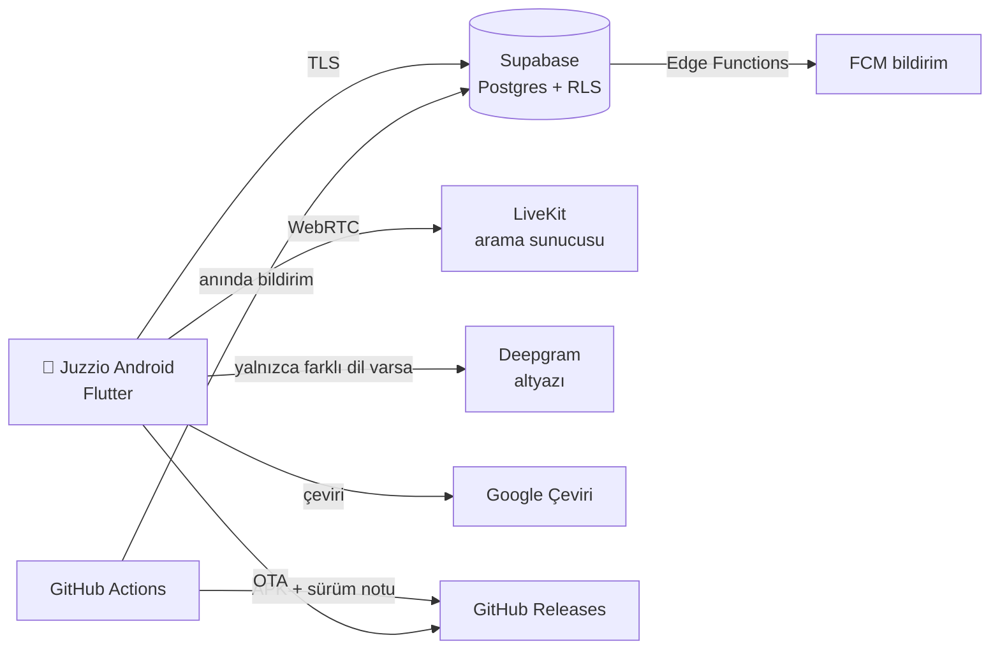

<div align="center">

# 🌍 Juzzio — Canlı Çevirili Sesli ve Görüntülü Arama, Uçtan Uca Şifreli Mesajlaşma

**Dünyayla kendi dilinde konuş.** Juzzio; **canlı sesli arama çevirisi**, **canlı görüntülü çeviri araması**, **çeviri destekli mesajlaşma**, hikâye, gönderi ve 4 kişilik konferans görüşmelerini tek bir modern, cam (glassmorphism) tasarımlı Android uygulamasında birleştirir.

[](https://github.com/engiincr/Juzzio-Chat/releases/latest)
[](https://github.com/engiincr/Juzzio-Chat/releases/latest/download/Juzzio-latest.apk)
[](#-beta--erken-erişim)
[](#-gizlilik-ve-güvenlik)
[](#-gizlilik-ve-güvenlik)
[](LICENSE)

🇹🇷 Türkçe · 🇬🇧 English · 🇩🇪 Deutsch · ve 100+ dilde çeviri

</div>

<!-- JUZZIO_DYNAMIC_TITLE_START -->
### 🚀 Son güncelleme: **v0.8.4 — Liquid Glass Tasarım Ailesi ve Tema Galerisi**
<!-- JUZZIO_DYNAMIC_TITLE_END -->

<!-- JUZZIO_VERIFIED_APK_START -->
| Sürüm | APK | Boyut | SHA-256 | Derleme |
| :-- | :-- | :-- | :-- | :-- |
| v0.8.4 (+1038) | [Juzzio-latest.apk](https://github.com/engiincr/Juzzio-Chat/releases/latest/download/Juzzio-latest.apk) | 99.17 MB | `2ddeaa96db0ca7e952b6f8feaa945024ce357e7e8105b02dc809db800fb513d7` | 2026-11-01 15:23 UTC |
<!-- JUZZIO_VERIFIED_APK_END -->

---

## 📑 İçindekiler

- [✨ Neler yapabilirsin?](#-neler-yapabilirsin)
- [🔐 Gizlilik ve güvenlik](#-gizlilik-ve-güvenlik)
- [📦 İndir ve kur](#-indir-ve-kur)
- [🆕 Sürüm geçmişi](#-sürüm-geçmişi)
- [🗄️ Veritabanı şeması](#️-veritabanı-şeması)
- [🏗️ Mimari](#️-mimari)
- [🛠️ Geliştirici kurulumu](#️-geliştirici-kurulumu)
- [🧪 BETA / Erken erişim](#-beta--erken-erişim)
- [⚖️ Lisans ve yasal](#️-lisans-ve-yasal)

---

## ✨ Neler yapabilirsin?

| | Özellik | Açıklama |
| :-: | :-- | :-- |
| 🎙️ | **Canlı çevirili sesli arama** | Farklı dil konuşan biri aramaya katıldığında konuşmalar anlık altyazıya ve senin diline çevrilir. Aynı dili konuşanlar arasında çeviri paneli açılmaz. |
| 🎥 | **Canlı çevirili görüntülü arama** | Yüzleri kapatmayan alt altyazı şeridi, cam kontrol rafı, ön/arka kamera, doğal güzellik modu. |
| 👥 | **Konferans (4 kişi)** | Süren aramaya kişi ekle, grup aramasına sonradan katıl, katılımcı yönetimi. |
| 💬 | **Çeviri destekli mesajlaşma** | Yazdığın her mesaj karşı tarafın dilinde görünür; "Orijinali gör" her zaman bir dokunuş uzakta. |
| 🔒 | **Uçtan uca şifreli mesajlar** | 1'e 1 yazılı mesajlar X25519 + AES-256-GCM ile cihazda şifrelenir. |
| 📞 | **Ayrıntılı arama geçmişi** | Başlangıç, cevaplanma ve bitiş saati, süre, **ilk kim kapattı**; arama kayıtları sohbette de görünür. |
| 🔔 | **Zil sesleri ve tonlar** | Juzzio'ya özel zil sesleri ve bildirim tonları; **kişiye özel** zil sesi ve ton. |
| 📸 | **Hikâye ve gönderi** | Kamera öncelikli stüdyo, filtreler, çıkartmalar, yazı stilleri; **yakın arkadaşlar** listesi. |
| 🎵 | **Müzik** | Şarkı adını yaz, listeden tek dokunuşla ekle; profilde oynat/durdur, hikâyede otomatik çalar. |
| 🧩 | **6 Android widget'ı** | Sohbet, hızlı eylemler, okunmamış, kamera, son arama, son sohbetler — temana ve diline uyar. |
| 🎨 | **Cam temalar** | Gece Mavisi, **Cam Beyaz**, Ametist, Zümrüt, Lagün, Krom · Gündüz / Gece / Sistem. |
| 🐣 | **Civciv oyunu** | Arkadaşınla saman yuvasındaki yumurtayı besle; beslendikçe titrer, çatlar ve büyür. |
| 🆕 | **Şeffaf güncellemeler** | Her sürümün neden geldiği, yenilikleri, düzeltmeleri ve güvenlik değişiklikleri uygulama içinde. |

---

## 🔐 Gizlilik ve güvenlik

> Ayrıntılar: **[PRIVACY.md](PRIVACY.md)** (Gizlilik Politikası ve KVKK Aydınlatma Metni) · **[TERMS.md](TERMS.md)** (Kullanım Koşulları). Aynı metinler uygulamada **Ayarlar → Yardım → Gizlilik, KVKK ve yasal haklar** altındadır.

- ❌ **Kişisel veri satılmaz**; reklam veya izleme (analitik) kütüphanesi yoktur.
- ❌ **Kart / banka bilgisi yoktur**; uygulamada ödeme kodu bulunmaz.
- ❌ **Kamera ve mikrofon izinsiz kullanılmaz**; yalnızca arama, hikâye kamerası ve sesli mesajda, Android izni verildikten sonra. Aramalar kaydedilmez.
- ❌ **Rehber, SMS ve konum okunmaz** (konum izni tamamen kaldırıldı).
- ✅ **1'e 1 yazılı mesajlar uçtan uca şifreli**; sunucu ve yöneticiler içeriği göremez.
- ✅ Satır düzeyi güvenlik (RLS): herkes yalnızca üyesi olduğu sohbetleri görür.
- ✅ Depoda gizli anahtar yoktur; her gönderimde **otomatik gizli bilgi taraması** (`scripts/check_secrets.py`) çalışır.
- ✅ Güncellemeler yalnızca resmi GitHub sürümünden; farklı imzalı APK üzerine kurulamaz.
- ℹ️ Sınırlar açıkça: grup mesajları ve medya henüz uçtan uca şifreli değildir; otomatik çeviri açıkken metin çeviri hizmetine gider.

🛡️ Bir güvenlik açığı bulursan lütfen herkese açık yazmadan **engiincr@pm.me** adresine bildir. Kapatılan açıklar sürüm notlarının **Güvenlik ve gizlilik** bölümünde duyurulur.

---

## 📦 İndir ve kur

1. 📥 [**Juzzio-latest.apk**](https://github.com/engiincr/Juzzio-Chat/releases/latest/download/Juzzio-latest.apk) dosyasını indir.
2. 📲 Android, "bilinmeyen kaynaklar" izni isterse bu kurulum için izin ver.
3. 🔄 Sonraki güncellemeler uygulama içinden gelir: yeni sürüm yayınlandığı anda bildirim alırsın, **Ertele** dersen seçtiğin süre boyunca rahatsız edilmezsin.

---

## 🆕 Sürüm geçmişi

<details open>
<summary><b>v0.8.0 — Kuantum sonrası şifreleme, şifreli Google Drive yedeği ve yumuşak cam arayüz</b></summary>

**Neden?** Mesajlaşmayı kuantum bilgisayarlara karşı bile güvenli hâle getirmek, telefon değiştirince hiçbir şeyin kaybolmamasını sağlamak ve arayüzü yumuşak, okunaklı cam tasarıma taşımak için.

- 🔐 **Kuantum sonrası uçtan uca şifreleme:** X25519 + **ML-KEM-768 (NIST FIPS 203)** hibrit anahtar değişimi, HKDF-SHA256, AES-256-GCM; "şimdi topla, sonra çöz" (HNDL) saldırılarına karşı koruma.
- 🔁 **Anahtar yenileme:** 50 mesajda / 24 saatte bir yeni oturum anahtarı, 30 günde bir yeni kimlik anahtarı.
- ☁️ **Şifreli Google Drive yedeği:** Argon2id + AES-256-GCM; yeni telefonda "Yedeği geri yükle".
- ✍️ **ML-DSA-65 (FIPS 204)** ile imzalanmış güncelleme bildirimi doğrulama altyapısı.
- 🎨 Yumuşatılmış cam tema, yeni Hakkında/yapımcı sayfası, ayrı yönetici giriş sayfası, hikâye halkası ve klavye düzeltmeleri.
- ⚖️ İzinsiz erişim ve saldırılara karşı yasal maddeler (TCK 132-136, 243-245, KVKK, FSEK, 5651).

</details>

<details>
<summary><b>v0.7.0 — Şeffaflık, uçtan uca şifreleme, zil sesleri, 6 widget ve yenilenen arayüz</b></summary>

**Neden?** Kullanıcı geri bildirimlerindeki tüm sorunları tek pakette çözmek, gizliliği güçlendirmek ve uygulamadaki her şeyi açıkça anlatmak için.

**✨ Yeni özellikler**
- 1'e 1 yazılı mesajlarda uçtan uca şifreleme (🔒 simgesi)
- Zil sesleri ve uyarı tonları: Juzzio'ya özel sesler, varsayılan ve **kişiye özel** zil sesi/bildirim tonu
- Kişi bilgisi sayfası: profil, sesli/görüntülü arama, süreli mesajlar, sessize al, özel tonlar, engelle
- Arama ayrıntısı sayfası (başlangıç/cevap/bitiş saati, süre, ilk kim kapattı), arama filtreleri; arama kayıtları sohbette görünür
- Müzik: YouTube kaldırıldı; isimle arama, tek dokunuşla ekleme, profilde oynat/durdur, hikâyede otomatik çalma
- Yakın arkadaşlar: hikâyeyi yalnızca seçtiğin favori arkadaşlar görür
- 6 farklı Android widget'ı (tema ve dil uyumlu)
- "Yenilikler: Sürüm X ile neler geldi?" penceresi — notlar GitHub'dan otomatik gelir
- Yeni sürüm yayınlanınca tüm kullanıcılara anında güncelleme bildirimi
- Cam Beyaz teması, modern üçlü tema seçici, yeniden tasarlanan güncelleme merkezi
- Ekran görüntüsüyle hata bildirme; uygulama içi Gizlilik / KVKK / Kullanım koşulları / Lisans
- Saman yuvası civciv sahnesi: beslendikçe titreyen ve çatlayan yumurta
- Yaylı ve dirençli "kaydır → yanıtla" animasyonu

**🛠️ Düzeltilen hatalar**
- Ertelenen güncelleme bildirimi uygulama her açıldığında tekrar çıkıyordu → erteleme kalıcı
- İki aynı dili konuşan arasında çeviri paneli açılıyordu → yalnızca farklı dil olunca açılır
- Görüntülü aramada yeşil konuşma halkası/çerçevesi kaldırıldı; sesli aramada "Ben" kartı kaldırıldı
- Aramalar sayfasında herkes çevrimiçi görünüyordu → yeşil nokta yalnızca gerçekten çevrimiçiyken
- Hikâye kamerasında ön/arka geçiş çalışmıyordu → kamera yeniden açılarak kalıcı çözüm
- Hikâye yazı boyutu paylaşınca değişiyordu → ekranda görüldüğü oranda paylaşılır
- Çekilen fotoğraf kayıyor/aynalanıyordu → vizördeki görüntüyle birebir, kayıpsız
- Sohbete girince ortadan rastgele bir mesaj açılıyordu → her zaman son mesaj
- Gönderilerde "çevrilemedi" hatası ve yazı kayması giderildi
- Yönetici teması herkese uygulanıyor ve değiştirmeyi engelliyordu → yalnızca yeni kullanıcılara bir kez
- Aydınlık temada beyaz üstüne beyaz yazılar, + düğmesi ve buton ton uyumsuzlukları
- Ekran görüşme sırasında kararıp sönüyordu → uygulama açıkken ekran açık kalır

**🔒 Güvenlik ve gizlilik**
- Aramalarda argo/küfür artık ceza sebebi değil ve konuşma sesi gereksiz yere üçüncü tarafa gönderilmiyor (altyazı yalnızca farklı dil varsa)
- Göstermelik "bulut yedekleme" ve "QR aktarım" ekranları kaldırıldı; verilerin gerçekte nasıl saklandığı açıklandı
- Sahip olunmayan bir alan adına giden paylaşım bağlantıları resmi indirme sayfasına çevrildi
- Gizli bilgi taraması README dahil tüm dosyalara genişletildi; push öncesi de çalışır
- Arka plandaki 24 saatlik uyanık kalma kilidi 10 dakikaya indirildi (pil)
- MIT lisansı yerine tescilli lisans: kopyalama, çoğaltma ve satış yasak
</details>

<details>
<summary><b>v0.6.1 — Şeffaf güncelleme notları ve gizlilik sıkılaştırması</b></summary>

- Uygulama içi **Güncelleme notları** sayfası (neden, yenilikler, düzeltmeler, güvenlik)
- Medya depolarında tüm dosyaların listelenebilmesi kapatıldı
- Kullanılmayan konum izni kaldırıldı
</details>

<details>
<summary><b>v0.6.0 — Glassmorphism tasarım, içerik denetimi, widget, yönetici paneli</b></summary>

- Uygulama genelinde aurora zemin + buzlu cam tasarım, 5 cam teması
- Ad, kullanıcı adı, grup adı ve profil fotoğrafında uygunsuz içerik denetimi
- Görüntülü aramada müstehcen görüntü denetimi ve ceza basamağı (1 saat → 4 saat → kalıcı)
- Android cam widget'ı; yönetici panelinde denetim, gruplar ve canlı aramalar
</details>

<details>
<summary><b>v0.5.x — Konferans yönetimi, nötr cam tasarım, tepkiler</b></summary>

- Katılımcıyı görüşmeden çıkarma (sunucuda doğrulanır), hikâye flaşı ve emoji çıkartmaları
- Bölüt tabanlı canlı çeviri, çift dokunuş tepkisi, mesaj yıldızlama, okunmamış sayısı
- Tüm veritabanı tek dosyada: `supabase/juzzio_database.sql`
</details>

<details>
<summary><b>v0.4.0 – v0.2.0 — Profil, arkadaşlık, içerik stüdyosu, gizli sohbetler</b></summary>

- Instagram tarzı profil ve profil kartı, arkadaş ekleme ve mesaj istekleri
- İçerik stüdyosu, video kırpıcı, filtreler; uygulama içi OTA güncelleme
- Her sohbet kendi odasında (RLS), kişiye özel arama sinyali, gizli anahtarlar depodan kaldırıldı
</details>

Tüm sürümler: [GitHub Releases](https://github.com/engiincr/Juzzio-Chat/releases)

---

## 🗄️ Veritabanı şeması

Tüm şema, fonksiyonlar, RLS politikaları ve tetikleyiciler **tek dosyadadır**: [`supabase/juzzio_database.sql`](supabase/juzzio_database.sql). Dosya tekrar çalıştırılabilir (idempotent) ve veri silmez.

```mermaid
erDiagram
    profiles ||--o{ room_participants : "üyedir"
    rooms ||--o{ room_participants : "içerir"
    rooms ||--o{ messages : "içerir"
    profiles ||--o{ messages : "gönderir"
    rooms ||--o{ call_logs : "arama"
    profiles ||--o{ call_logs : "arar / aranır"
    profiles ||--o{ friendships : "arkadaşlık"
    profiles ||--o{ stories : "paylaşır"
    stories ||--o{ story_views : "görüntülenir"
    profiles ||--o{ close_friends : "yakın arkadaş listesi"
    profiles ||--o{ posts : "paylaşır"
    posts ||--o{ comments : "yorum"
    profiles ||--o{ notifications : "alır"
    profiles ||--o| user_sound_prefs : "zil sesleri"
    profiles ||--o{ app_feedback : "hata bildirir"
    profiles ||--o{ moderation_strikes : "ihlal"
    app_releases ||--o{ app_releases : "sürümler"

    profiles {
        uuid id PK
        text username "benzersiz"
        text display_name
        text avatar_url
        text e2ee_public_key "yalnızca AÇIK anahtar"
        text music_url "30 sn önizleme"
        bool is_online
    }
    rooms {
        uuid id PK
        bool is_group
        text title
        text disappearing_timer "off / 24h / 7d / 30d"
    }
    messages {
        uuid id PK
        uuid room_id FK
        uuid sender_id FK
        text message_type "text / voice / image / call ..."
        text original_text "şifreliyse boş"
        jsonb metadata "e2ee yükü, arama kaydı"
    }
    call_logs {
        uuid id PK
        uuid session_id
        text status "ringing / answered / missed / rejected"
        timestamptz answered_at
        timestamptz ended_at
        uuid ended_by "ilk kapatan"
    }
    close_friends {
        uuid owner_id PK
        uuid friend_id PK
    }
    user_sound_prefs {
        uuid user_id PK
        text message_tone
        text ringtone
        jsonb contact_prefs "kişiye özel"
    }
    app_releases {
        text version_name PK
        int version_code
        jsonb details "neden / yenilikler / düzeltmeler / güvenlik"
    }
    app_feedback {
        uuid id PK
        text kind "bug / feedback / idea"
        text message
        text status
    }
```



> Not: Şema yalnızca tablo yapısını gösterir; anahtar, şifre veya bağlantı bilgisi içermez.

---

## 🏗️ Mimari



```
lib/
  core/            tema, cam bileşenleri, sesler, sürüm notları, yasal metinler
  services/        Supabase veri katmanı, uçtan uca şifreleme, LiveKit, sosyal
  screens/         sohbetler, aramalar, ayarlar, yönetici paneli, stüdyo, profil
  widgets/         müzik, video, yaylı yanıt hareketi, civciv yuvası
android/           widget'lar, bildirim kanalları, zil sesleri (res/raw)
supabase/          juzzio_database.sql · tests/ · functions/
scripts/           güvenli push, sürüm notları, gizli bilgi taraması
```

---

## 🛠️ Geliştirici kurulumu

1. **Veritabanı:** `supabase/juzzio_database.sql` dosyasını Supabase SQL Editor'de bir kez çalıştırın veya CI'ın uygulaması için GitHub Secrets'a `SUPABASE_DB_URL` ekleyin.
2. **Edge Function gizli değerleri** (Supabase → Edge Functions → Secrets): `LIVEKIT_URL`, `LIVEKIT_API_KEY`, `LIVEKIT_API_SECRET`, `DEEPGRAM_API_KEY`, `FCM_SERVICE_ACCOUNT_JSON`, `PUSH_WEBHOOK_SECRET`, isteğe bağlı `GOOGLE_VISION_API_KEY`.
3. **GitHub Secrets:** `ANDROID_KEYSTORE_BASE64`, `ANDROID_KEYSTORE_PASSWORD`, `ANDROID_KEY_PASSWORD`, `ANDROID_KEY_ALIAS`, `GOOGLE_SERVICES_JSON_BASE64`, `SUPABASE_DB_URL`, `SUPABASE_ACCESS_TOKEN`, `SUPABASE_PROJECT_REF`.
4. **Gönderim:** `push.bat "mesaj"` (Windows) veya `bash scripts/push.sh "mesaj"`. Betik önce gizli bilgi taraması yapar.
5. **Yeni sürüm notu:** `version.json` içindeki `details` alanını doldurun; GitHub sürüm sayfası, uygulamadaki "Yenilikler" penceresi ve anlık bildirim buradan otomatik üretilir.

> ⚠️ **Asla** gerçek anahtar, şifre, bağlantı adresi veya kişisel bilgi README'ye, koda ya da sürüm notlarına yazmayın. Tarama bulursa CI ve push betiği durur.

---

## 🧪 BETA / Erken erişim

Juzzio bir **BETA (Erken Erişim)** uygulamasıdır. Özellikler gelişmeye devam ediyor. Hata görürsen uygulamada **Ayarlar → Yardım → Hata bildir** bölümünden ekran görüntüsüyle bildirebilirsin.

---

## ⚖️ Lisans ve yasal

**Tüm hakları saklıdır.** Juzzio tescilli bir yazılımdır; kaynak kodu yalnızca şeffaflık ve güvenlik incelemesi için görüntülenebilir. **Kopyalanması, çoğaltılması, dağıtılması, satılması ve türev uygulama yapılması yazılı izin olmadan yasaktır.** Ayrıntılar: [LICENSE](LICENSE) · [PRIVACY.md](PRIVACY.md) · [TERMS.md](TERMS.md).

<div align="center">

**Juzzio** · canlı çeviri · sesli arama çevirisi · görüntülü arama çevirisi · çok dilli sohbet · uçtan uca şifreli mesajlaşma · Android

</div>
