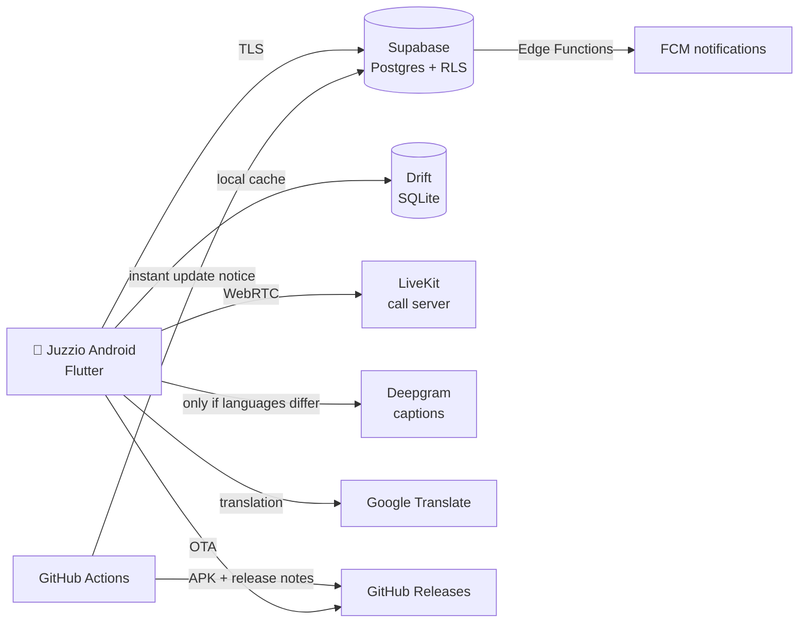

<div align="center">

# 🌍 Juzzio — Live-Translated Voice & Video Calls, End-to-End Encrypted Messaging

**Talk to the world in your own language.** Juzzio brings **live voice call translation**, **live video call translation**, **translated messaging**, stories, posts and 4-person conference calls together in one modern Android app with a Liquid Glass (glassmorphism) design.

[](https://github.com/engiincr/Juzzio-Chat/releases/latest)
[](https://github.com/engiincr/Juzzio-Chat/releases/latest/download/Juzzio-latest.apk)
[](#-beta--early-access)
[](#-privacy--security)
[](#-privacy--security)
[](LICENSE)

🇬🇧 English · 🇹🇷 Türkçe · 🇩🇪 Deutsch · and translation into 220+ languages

🌐 **Website:** [engiincr.github.io/Juzzio-Chat](https://engiincr.github.io/Juzzio-Chat/) · **Juzzio** — live translation video call app, translated voice calls, end-to-end encrypted messenger

</div>

<!-- JUZZIO_DYNAMIC_TITLE_START -->
### 🚀 Latest update: **v1.2.4 — Offline-first Juzzio, Smooth Chats & Replyable Notifications**
<!-- JUZZIO_DYNAMIC_TITLE_END -->

<!-- JUZZIO_VERIFIED_APK_START -->
| Version | APK | Size | SHA-256 | Built |
| :-- | :-- | :-- | :-- | :-- |
| v1.2.4 (+1061) | [Juzzio-latest.apk](https://github.com/engiincr/Juzzio-Chat/releases/latest/download/Juzzio-latest.apk) | 112.18 MB | `c76f065349909384479e1b2f4d29e622b171c72d0a31710cf615d78ea0868264` | 2026-11-10 07:20 UTC |
<!-- JUZZIO_VERIFIED_APK_END -->

---

## 📑 Contents

- [🆕 Latest updates (November 10, 2026)](#-latest-updates-november-10-2026)
- [✨ What can you do?](#-what-can-you-do)
- [🔐 Privacy & security](#-privacy--security)
- [📦 Download & install](#-download--install)
- [🗂️ Release history](#️-release-history)
- [🗄️ Database schema](#️-database-schema)
- [🏗️ Architecture](#️-architecture)
- [🛠️ Developer setup](#️-developer-setup)
- [🧪 BETA / Early access](#-beta--early-access)
- [⚖️ License & legal](#️-license--legal)

---

## 🆕 Latest updates (November 10, 2026)

**v1.2.4** is the newest release (after v1.2.3, v1.2.2, v1.2.1, v1.2.0, v1.1.1 and the November 9 releases v0.9.4 → v1.1.0). Every update below is also shown inside the app on the first launch after updating ("What's new?"), with the same sections and emojis. Full notes: [release-notes.md](release-notes.md) · [GitHub Releases](https://github.com/engiincr/Juzzio-Chat/releases).

<details open>
<summary><b>v1.2.4 — Offline-first Juzzio, Smooth Chats & Replyable Notifications</b></summary>

### 🎯 Why did this update come?
Explore, chats, stories, calls, notifications, profile and tasks now open in their last-loaded state without internet; everything refreshes on its own when the connection returns and offline profile/settings changes are applied. The chat stutter when scrolling up is fixed at the root. Notifications are expandable with Reply and Mark as read. The admin legal bundle error (P0001) and the version field are fixed, the locked-chat PIN bypass is closed and the whole app switches language instantly.

### ✨ What's new?
- 📶 Offline-first: Explore opens in its last-loaded state; an "No internet connection" row where the cache ends; uncached images show a spinning loader and load by themselves when back online
- 📞 Calls page cached; toggling internet no longer empties it; pull-to-refresh added
- 🔔 Notifications, 👤 profile (posts, saved, counters, friends' profiles) and ✅ tasks/reminders are cached in the background and viewable offline
- 🎵 Profile music plays offline after the first listen; 📖 stories are pre-downloaded and watchable offline
- ✏️ Profile and settings changes made offline are kept and applied when you reconnect
- 💬 Expandable chat notifications: sender photo and name, group/channel name, stacked messages; Reply and Mark as read without opening the app
- 🖼 Received photos, videos and documents are saved to the gallery (Juzzio folder) and open offline (toggle in Settings → Chats; view-once never saved)
- ⚡ No waiting when sending photos, videos and documents: they appear instantly and upload in the background
- 😍 Tap a reaction badge to see who reacted with what (one reaction per person)
- 📤 Forward Explore posts and stories to 1:1 chats and groups; "Open post / Open story" button in chat
- 🧑‍💼 Admin panel greets you with your current photo; minimum version is picked from past packages with build number, ID, SHA-256, ML-DSA fingerprint and date
- 🎬 Glass "Portfolio · Creator Showreel" button on the creator page: a 26 s video starting with "Hello…" (plays offline)
- 🌍 Changing the app language instantly updates EVERY open screen, including sign-up/login policies, admin panel and dialogs
- ♀♂ Pink/blue gender icons at sign-up; password strength meter; +1 animation when adding a friend

### 🛠 Fixes
- Chat stutter when scrolling up: swipe-to-reply no longer steals vertical scrolling; loading older messages no longer yanks you to the bottom
- Locked chats could be opened without the PIN: creating a PIN no longer unlocks; the lock closes again after 2 minutes and when leaving the chat
- Admin → Emergency → Legal bundle P0001: username is resolved on the server (case-insensitive) with clear errors for missing reason and expired session
- Minimum supported build couldn't take versions like 1.0.2: now picked from a package list
- People without a status no longer appear in the status strip
- Offline chats show the real last seen instead of "Last seen hidden"
- Every message type (view-once, contact card, location, video, image, poll, event, document) can be deleted from the long-press menu
- CI: failing test details are now visible on GitHub; admin log sentences and ambiguous imports are checked locally before push

### 🔐 Security & privacy
- Locked-chat unlock expires and re-locks on exit; the PIN is never stored
- Notification avatars are downloaded only from public https URLs with a 3 s limit; nothing is sent in hidden preview mode
- Only files from the app's own folders are saved to the gallery; encrypted media is decrypted on device and the temp file deleted; view-once media is never saved
- Legal bundle still requires the super-admin password session, a reason and is audit-logged
- End-to-end encryption, RLS and storage rules unchanged

</details>

<details>
<summary><b>v1.2.3 — Simpler Sign-up Consent (per KVKK 2026 guidance)</b></summary>

### 🎯 Why did this update come?
The four separate consent boxes on the sign-up and sign-in screen were reduced to two, in line with the Turkish Data Protection Board's Principle Decision No. 2026/347 (privacy notice and consent kept separate, no consent taken in the notice) and the 2024 amendment of KVKK Art. 9 (continuous transfers abroad rely on standard contracts). Tapping the box opens the text automatically; scroll to the end, tap "I have read and understood" and sign-up or sign-in completes.

### ✨ What's new?
- ✅ Only two boxes: (1) required — "I accept the Terms of Use and confirm I am over 15. I have read and understood the Privacy Notice." (2) optional — news and campaign e-mails
- 📖 Tapping the box opens the Privacy Notice and Terms; "Scroll to end" takes you to the bottom, where "I have read and understood" becomes active and ticks the box
- 🚀 Tapping "Sign up" / "Sign in" without the tick opens the text automatically; after confirming, the action continues and completes
- 📧 Marketing consent opens its own text, is never pre-ticked and is given with "I agree"

### 🛠 Fixes
- Privacy Notice rewritten with every element required by the Turkish notice regulation: controller, data, collection method, purposes and legal bases, recipients, basis for transfers abroad, retention, rights, how to apply and the right to complain to the Board
- Removed the separate "consent to cross-border transfer": continuous transfers rely on appropriate safeguards (standard contracts) under KVKK Art. 9 and are explained in the notice
- Age requirement added to the Terms (15+, under 18 with a parent's or guardian's knowledge); Privacy Policy children and rights sections updated
- Existing users see the updated texts once

### 🔐 Security & privacy
- The server only requires the mandatory statement (terms + age 15+ + notice read); cross-border consent is no longer required
- Consent records keep version, time and app version (no IP); clients cannot write the consent columns directly

</details>

<details>
<summary><b>v1.2.2 — The Send-Message Flight Is Back</b></summary>

### 🎯 Why did this update come?
In v1.2.0 the font change, pink glow and bounce when sending were 'fixed' by turning the flight effect off instead of fixing the cause. This update fixes all three causes at the source and brings back the message flight from the composer to the bubble.

### ✨ What's new?
- 🕊 The send-message flight is back: your text lifts off the composer, glides like a droplet and becomes the chat bubble

### 🛠 Fixes
- No more font change: the flying text uses exactly the bubble's font, size, weight and line height, laid out at the bubble's width so line breaks don't change mid-flight
- No more pink glow: the capsule is no longer painted with the accent colour and a pink shadow; it blends from the composer colour into the bubble's own colour
- No more bounce: the capsule lands on the real bubble's position (tracked every frame, even while the list scrolls) with a non-overshooting curve; the bubble no longer scales in separately, it takes over on the exact landing frame
- No double bubble if the server confirms before the flight ends
- Still off with Reduce motion and Performance mode; no flight for big emoji, replies, contact cards and locations

### 🔐 Security & privacy
- Visual-only change; encryption, sending and server rules are unchanged

</details>

<details>
<summary><b>v1.2.1 — Consent at Sign-up, Weather Theme & New Refresh Hand</b></summary>

### 🎯 Why did this update come?
This update adds a clear consent form at sign-up and login (privacy notice, explicit consent, age 15+, cross-border transfer, optional marketing e-mails), server-side rate limits and input validation, a theme that follows your local weather and a pull-to-refresh rewritten with a chubby 3D baby hand like the reference image. The call-history arrows and the truncated profile buttons seen in the v1.0.0 recording are fixed too.

### ✨ What's new?
- ✅ Sign-up / login consent form with custom animated ticks; privacy notice, Terms, "I am over 15" and cross-border transfer (Supabase, LiveKit, Firebase, Open-Meteo) are required — you can't register or log in without them
- 📧 Optional "Campaign and news e-mails" (marketing consent); withdraw any time in Settings → Notifications
- 🔐 The form explains end-to-end encryption (E2EE) and the security measures in plain words; "Read" links open the full texts
- 🔄 If the consent text changes, existing users see a one-time re-consent dialog (declining signs you out)
- 🌦 Weather theme (on by default): sun/moon glow, clouds, fog, drizzle, rain, snow and lightning effects from your local weather. Turn it off in Appearance → Weather theme
- 👶 Pull-to-refresh rewritten: a chubby 3D clay baby hand with 4 fingers and a thumb, staying in the gap between the Dynamic Island and the header (max 80 dp), a soft 3D cloth-pinch shade at the threshold, a 200 ms elastic snap back on release, then a minimal spinner in the gap

### 🛠 Fixes
- Refresh fires exactly once (duplicate lock); releasing below the threshold cancels cleanly; all controllers are disposed
- With Reduce motion on, the hand animation is skipped and only the standard spinner is shown
- Removed the old 2D fan / radial lines and the white nail circles; the hand no longer touches the header, search bar or avatars
- Call history: no more double arrows — one icon with the incoming ↙ / outgoing ↗ direction
- Your profile's "Edit profile" / "Share profile" buttons are no longer truncated: "Edit" and "Share"
- Clearer profile photo zoom option: "Turn off/on zoom for others"

### 🔐 Security & privacy
- Consents are recorded on the server with their version (you only see your own; clients can't write the consent columns directly)
- Server-side rate limits: messages 40/min and 3000/day, comments 20/min, posts 30/hour, stories 60/day, friend requests 40/hour, reports 20/hour, group creation 20/hour, consent records 20/hour
- Input validation: control and invisible/bidi characters are stripped, length limits enforced on the server; dangerous links such as javascript:, data:, file: are rejected; user search terms are limited to letters/digits/_/-
- For the weather theme your location is rounded to ~10 km and sent only to Open-Meteo — never to Juzzio's server and never stored. Location permission is asked only once
- End-to-end encryption behaviour unchanged (fail-closed); RLS not weakened; storage buckets not made public

</details>

<details>
<summary><b>v1.2.0 — Birthday Celebration, Juzzio Community & Channels</b></summary>

### 🎯 Why did this update come?
This update closes all 18 issues you reported: a birthday celebration, real channels and a Juzzio Community everyone joins automatically, all Appearance settings on one page, fixed message and call reactions, redesigned message cards, in-chat search and working locked chats.

### ✨ What's new?
- 🎂 Birthday celebration: when a message contains "Happy Birthday", "Doğum günün kutlu olsun" (and similar), two hands with party poppers come in from the left and right and pop, 🌸🎂😍⚡🥳💖❤️ rise and fade smoothly and an electric wave runs around the bubble — 4 seconds in total
- 📣 Real channels: "New channel" now opens its own flow (name + description + live preview → pick people). Only owners and admins post; members read and react (enforced on the server)
- 🌍 Juzzio Community: an official channel named in your app language. Every existing user and every new sign-up joins automatically; posts appear as "Juzzio Official" with a blue tick and the app logo
- 🚀 Release notes are posted to Juzzio Community automatically on every update (no admin effort, never twice for the same version)
- 🛠 New "Juzzio Community" admin page: text, link, image, video, music or any file → "Share" to every user
- 🎨 Appearance on one page: Light/Dark (Light · Dark · System · Scheduled), app theme, glass theme, Theme Studio, chat theme and brightness, font size with live preview, performance mode
- 🕰 Scheduled light/dark mode: choose when dark mode starts and ends
- 🗂 Settings reorganised: Account & security · Chats & notifications · Appearance & language · Storage & battery · Support
- 🔍 New message search: glass search field, filter chips with icons, date headers, highlighted matches; opened from a chat (⋮ → Search in chat) it searches only that chat and jumps to the message
- 🔒 Locked chats completed: creates a PIN if needed, lists locked chats, lock/unlock chats right there
- 🪪 Contact card: tappable, with the shared person's photo, name, blue tick and "View profile"
- 💣 View-once media: blurred preview, glass "View once" label and glass bomb icon; modern "Opened" state afterwards, can't be reopened
- 📸 Story replies redesigned: full thumbnail, big reaction emoji in the corner, tap opens the story
- 💬 Story notifications: "Fikret39 reacted 🌸 to your story" and "Fikret39 commented on your story: …"
- 📅 Shared shift plans are tappable cards with a day-by-day viewer (hours and days off)
- 🗓 My shifts page redesigned: month header with summary, next-shift card, gradient calendar cells, colour chips, card-style team calendar
- ⏰ Schedule message: write the message right in the sheet; separate date and time pickers and quick presets
- ✨ "What would you like to share?": stronger blur, readable text, new Post and Story/Status icons
- 🫧 The live activity pill now sits below the header as transparent glass and no longer covers the profile photo and name

### 🛠️ What was fixed?
- Removed the font change, pink glow and bounce when sending; the bubble appears instantly and calmly
- Message reactions no longer shrink or break; the badge is larger, colourful and never clipped; ❤️‍🔥 is no longer drawn as a plain heart
- Call reactions: the emoji you pick by long-press is sent on every tap (it used to revert to ❤️); yellow lines under the hearts are gone
- Call screen: modern glass data-saver card; the battery-saver black screen now shows live captions and translation
- On Notifications the refresh hand grabs the top edge of the list, not the header
- Fixed the light/dark mismatch and the two conflicting controls in Appearance
- Tapping "Font size" no longer jumps to chat settings
- Performance mode really works: blur, confetti/particle and celebration effects and springy entrances are turned off

### 🔐 Security & privacy
- Channel posting rule enforced on the server (stricter RLS); the community channel can't be created or changed by clients and its name is reserved
- Community posts and release announcements can only be made by the admin/server
- In encrypted chats the text of a story comment is never written to the server or notification (only the reaction emoji, like message reactions)

<details>
<summary>🇹🇷 Türkçe — Bu güncelleme neden geldi?</summary>

Bu güncelleme bildirdiğin 18 eksiğin tamamını kapatıyor: doğum günü kutlaması, gerçek kanallar ve herkesin otomatik üye olduğu Juzzio Topluluğu, tek sayfada toplanan Görünüm ayarları, düzeltilen mesaj ve arama tepkileri, yenilenen mesaj kartları, sohbet içi arama ve çalışan kilitli sohbetler.

**Yenilikler**
- 🎂 Doğum günü kutlaması: "Happy Birthday", "Doğum günün kutlu olsun", "İyi ki doğdun" (ve benzerleri) geçen mesajda soldan ve sağdan konfeti patlatıcılı iki el girip patlatır, 🌸🎂😍⚡🥳💖❤️ yumuşakça yükselip kaybolur, balonun çevresinde elektrik dalgası dolaşır — toplam 4 saniye
- 📣 Gerçek kanallar: "Yeni kanal" artık grup formunu değil kendi akışını açar (ad + açıklama + canlı önizleme → kişi seçimi). Kanalda yalnız sahip ve yöneticiler paylaşır; üyeler okur, tepki verir (sunucuda da zorunlu)
- 🌍 Juzzio Topluluğu: uygulama dilinde adlandırılan resmî kanal (TR "Juzzio Topluluğu", EN "Juzzio Community"). Tüm mevcut kullanıcılar ve her yeni kayıt otomatik üye; paylaşımlar "Juzzio Official" adı, mavi tik ve uygulama logosuyla görünür
- 🚀 Her güncelleme yayınlandığında sürüm notları Juzzio Topluluğu'nda otomatik paylaşılır (yönetici emeği yok, aynı sürüm iki kez paylaşılmaz)
- 🛠 Yönetici paneline "Juzzio Community" sayfası: metin, bağlantı, görsel, video, müzik veya herhangi bir dosya seçip "Paylaş" ile tüm kullanıcılara duyuru
- 🎨 Görünüm tek sayfada: Gece/Gündüz (Gündüz · Gece · Sistem · Zamanlı), uygulama teması, cam teması, Tema Stüdyosu, sohbet teması ve parlaklığı, canlı önizlemeli yazı boyutu, performans modu
- 🕰 Zamanlı gece/gündüz modu: gece modunun başlayıp biteceği saati seç, uygulama kendisi geçer
- 🗂 Ayarlar yeniden düzenlendi: Hesap ve güvenlik · Sohbetler ve bildirimler · Görünüm ve dil · Depolama ve pil · Destek
- 🔍 Mesaj araması yenilendi: cam arama kutusu, simgeli filtreler, tarih başlıkları, eşleşen kelime vurgusu; sohbet içinden açılınca (⋮ → Sohbette ara) yalnız o sohbette arar, sonuca dokununca mesaja kaydırıp vurgular
- 🔒 Kilitli sohbetler tamamlandı: PIN yoksa oluşturur, varsa açar; kilitli sohbetler listelenir, buradan sohbet kilitlenir/kilidi kaldırılır
- 🪪 Kişi kartı: dokunulabilir, paylaşılan kişinin profil fotoğrafı, adı, mavi tiki ve "Profili Görüntüle" düğmesi
- 💣 Tek görüntülemelik medya: bulanık önizleme, cam "Tek görüntülemelik" etiketi ve cam bomba simgesi; açıldıktan sonra modern "Açıldı" durumu, tekrar açılamaz
- 📸 Hikâye yanıtları yeni tasarım: tam küçük görsel, köşede büyük tepki emojisi, dokununca hikâye açılır (eski çerçeve ve "İzle" düğmesi kaldırıldı)
- 💬 Hikâye bildirimleri: "Fikret39 hikâyene 🌸 tepkisi verdi" ve "Fikret39 hikâyene "…" yorumunu ekledi" (Instagram gibi)
- 📅 Paylaşılan vardiya planı artık dokunulabilir kart: gün gün hangi saatler çalışılacağı ve hangi günlerin izin olduğu ayrıntılı görüntüleyicide
- 🗓 Vardiya planım sayfası baştan tasarlandı: ay başlık kartı ve özet (çalışma günü, izin, saat), sıradaki vardiya kartı, degrade takvim hücreleri, renk etiketleri, kart görünümlü ekip takvimi
- ⏰ Mesajı zamanla: mesaj bu sayfada yazılır; ayrı tarih ve saat seçici, hızlı seçenekler (1 saat, 3 saat, yarın 09:00)
- ✨ "Ne paylaşmak istersin?": güçlü bulanıklık, okunur metin, yeni Gönderi ve Hikâye/Durum simgeleri
- 🫧 Canlı durum kapsülü ("Ses kaydediliyor", "Fotoğraf gönderiliyor") artık başlığın altında, şeffaf cam görünümünde — profil fotoğrafını ve adı örtmüyor

**Düzeltmeler**
- Mesaj gönderirken yazı tipinin değişmesi, pembe parıltı ve zıplama tamamen kaldırıldı; balon beklemeden ve sakin şekilde belirir
- Mesaj tepkileri: emoji küçülüp bozulmuyor, rozet büyük, renkli ve kırpılmadan görünüyor; ❤️‍🔥 artık düz kalp olarak çizilmiyor
- Arama tepkileri: basılı tutup seçtiğin emoji (⚡, 🎉 …) artık her dokunuşta gönderilir (önceden bir kez gidip ❤️'ye dönüyordu); kalplerin altındaki sarı çizgiler giderildi
- Arama ekranı: mobil veri uyarısı modern cam kart oldu (sarı alt çizgi ve bozuk yazı tipi yok); pil tasarrufu siyah ekranı canlı altyazı ve çeviriyi gösteriyor
- Bildirimlerde yenileme eli başlık yazısının üstünden değil listenin üst kenarından tutuyor
- Görünüm'deki gece/gündüz uyuşmazlığı ve birbiriyle çakışan iki kontrol giderildi (tek seçici; özel tema etkinken seçim artık uygulanıyor)
- "Yazı boyutu"na dokununca sohbet ayarlarına atma sorunu giderildi
- Performans modu gerçekten çalışıyor: bulanıklık, konfeti/parçacık ve kutlama efektleri ile yaylı girişler kapanıyor

**Güvenlik**
- Kanallarda paylaşım kuralı sunucuda zorunlu (RLS sıkılaştırıldı); topluluk kanalı istemciden oluşturulamaz/değiştirilemez, adı rezervedir
- Topluluk paylaşımı ve sürüm duyurusu yalnız yönetici/sunucu tarafından yapılabilir
- Şifreli sohbette hikâye yorumunun metni sunucuya ve bildirime yazılmaz (yalnız tepki emojisi, mesaj tepkileri gibi)

</details>

### 🧭 How it works (details)
- **Birthday** — detection is local (TR/EN/DE/ES/FR/IT/RU phrases); plays once per new message (last 8 s), never while scrolling old messages, not at all with *Reduce motion* or *Performance mode*. Everything is vector-drawn (no image assets).
- **Channels** — `rooms.is_channel`; the `messages_insert_member` RLS policy now rejects posts from members who are not owner/moderator.
- **Juzzio Community** — a single `rooms.is_community` channel (unique index). `juzzio_ensure_community()` creates it once the admin profile exists and backfills every user; `trg_juzzio_profile_join_community` adds each new sign-up (users who left are not re-added). The name is reserved by trigger and shown per app language.
- **Release announcement** — CI step *"Juzzio Topluluğu sürüm duyurusu"* runs `scripts/community_release_post.py` → `juzzio_community_post_release(version, tr, en)` (server role only, idempotent per version).
- **Admin composer** — Admin → *Juzzio Community* → `admin_community_post()` (admin only; https media only; audited).
- **Story notifications** — preview keys `storyreact|🌸` / `storycomment|text`; encrypted comments keep an empty preview.

</details>

<details>
<summary><b>v1.1.1 — New Refresh Hand & Faster Profile</b></summary>

### 🎯 Why did this update come?
The chubby pull-to-refresh hand was redrawn as vector art; the notifications list no longer disappears while refreshing, and the profile page opens much faster.

### ✨ What's new?
- ✋ Redrawn refresh hand: a chubby, clean-lined hand comes out of the notch with a sleeve in your theme colour, swings, makes a fist and pulls the page up — crisp on every screen
- 🧺 The cloth is now a light surface in your theme colour that gathers up with soft folds

### 🛠️ What was fixed?
- Fixed the refresh hand looking like a foot and ghosting between poses
- Fixed the cloth looking like a black smear over the content in dark themes
- Notifications: refreshing or switching filters no longer flashes empty placeholder cards; stale requests can't overwrite the new list; empty/error states can be pulled to refresh; swipe-to-delete removes by id
- Profile: counts, posts and relationship appear as soon as each arrives and reopen instantly; background requests run in parallel instead of one after another
- Friends, files, saved messages, security and post comments no longer lose their content while refreshing

</details>

<details>
<summary><b>v1.1.0 — Live Motion, New Logo & Clean Captions</b></summary>

### 🎯 Why did this update come?
Juzzio now feels alive at every touch: page transitions, switches, loaders, message sending, likes and icon morphs were redesigned, and there is a new logo. Phantom captions like "Okay my love" that users never said are gone from calls, and tapping a quote jumps to the quoted message.

### ✨ What's new?
- 🐣 New logo: a chick with a glass chat-bubble wing and an orbit ring; Android adaptive and themed (monochrome) icon, new launch screen
- 🚀 Launch/loading screen: a glowing orbit around the logo, a sparkler progress bar and "Connecting → Verifying encryption → Syncing messages"
- 💬 Sending: the text in the composer breaks off like a droplet, turns into a bubble and slides up; the paper plane on the send button flies off with a swoosh
- ✓✓ Read receipts draw themselves: clock → ✓ sent → ✓✓ delivered → glowing ✓✓ read
- 😀 Emoji-only messages arrive big with a pop; messages like "Happy Birthday", "Congrats" or "İyi ki doğdun" burst into confetti
- ❤️ Reactions: the heart draws itself and fills with a ring and particle burst; new reaction badges spring in; double-tap a photo for a heart
- ⭐ Starring a message spins the star with sparkles
- 🔘 New switches: a gooey neon switch for general settings; ✕→✓ switches for privacy, encryption, read receipts and permissions; a Day/Night switch where the sun turns into the moon
- ⏻ Live translation and Do Not Disturb get a one-tap neon Power button
- 🧭 Transitions: bottom sheets blur the background and spring open; photos and videos zoom to full screen from where you tapped; the profile photo flies seamlessly into the profile page
- ➕ Icon morphs: attach (+) turns into × while the menu is open, ⋮ turns into ×, the inbox menu becomes × inside a ring, the back button morphs from menu to arrow
- 🏝️ Dynamic Island–style live activity: ongoing calls, voice recording and uploads appear at the top with a timer/progress
- 🫧 Copied, microphone on/off and live translation states show as a glass HUD that doesn't cover the screen; deleting a message is confirmed with an action sheet
- 🎉 Live reactions in calls: tap the heart (hold to pick another reaction) and it floats up on everyone's screen
- ⌛ Three glowing dots bounce at the bottom of the chat while the other person types; sparkler bars for uploads and an orbit ring while connecting
- 📳 Haptic feedback on send, switches, swipe thresholds and long presses

### 🛠️ What was fixed?
- Fixed made-up captions such as "Okay my love" appearing in voice/video calls while nobody was speaking: the caption microphone now uses echo cancellation and noise suppression with auto-gain off, and the recognizer only receives silence unless you are actually speaking
- The other person's voice leaking from the speaker into your microphone is no longer written as a "You: …" line (echo filter); low-confidence and phantom-phrase results are dropped and a stale interim line is retracted
- Tapping a quote (the replied message) scrolls the chat to the quoted message and highlights it briefly; older history loads automatically
- Image quotes show a thumbnail instead of caption text; video, voice and document quotes show their type

### 🔐 Security
- Live captions only send audio to the speech recognizer while you are actually speaking; silence and room sound are not sent
- Call reactions are limited to an allow-list of emojis (no arbitrary text can be broadcast)

</details>

<details>
<summary><b>v1.0.0 — Juzzio Space: New Design & Instant Messaging</b></summary>

### 🎯 Why did this update come?
Juzzio moves to the "Juzzio Space" interface designed in Figma: deep theme gradients, frosted glass cards and a glowing accent in every theme. In the same update messages send without waiting, location/link/poll experiences were rebuilt, shifts can be planned by date range and admin logs became readable.

### ✨ What's new?
- 🎨 Juzzio Space design: "Your space · Juzzio." header, search with a ⌘K shortcut, story rings, Inbox · Messages, filter pills with counters, glass chat cards and a floating glass bottom bar
- 🌈 All 16 themes share the same design language; accent, background depth and glass opacity come from the selected theme (Emerald is the default for new users)
- ⚡ Messages send instantly: the bubble appears right away, translation runs in the background and shows up under the message when ready (in end-to-end encrypted chats the translation is added encrypted too)
- 📍 Shared locations appear as a card with a map preview and open in Google Maps on Android, Apple Maps on iOS, or Google Maps
- 🔗 Links, e-mail addresses and phone numbers in messages, bios, posts and comments are tappable and open in the default browser/app
- 🪪 Profile and admin panel use the Juzzio Space layout too: large header, square avatar with a glowing ring, glass counter tiles, accent primary button, capsule tabs and glass stat cards
- 📊 New poll card: options with share bars, percentages, winner highlight and a live status chip
- 📅 Date ranges in the shift planner: pick start–end days and hours (overnight shifts included), filter weekdays/weekends, share with a group and post a plan summary automatically
- 🐣 When petted, the chick twirls to the right like a princess, winks and flirts; the chick badge in chats does the same animation
- 👑 New chick customizations: princess tiara, flower crown, wizard hat, star glasses, princess tutu, pearl necklace, ballet shoes, Castle/Space/Sakura scenes
- 🧾 Admin logs are readable sentences in the admin's language: who did what, to whom and when (no raw codes or IDs)

### 🛠️ What was fixed?
- Cloth pull-to-refresh fixed on mobile: no more conflict with Android's stretch overscroll or iOS bouncing, and short lists can be pulled too
- Removed the GPU blur artifact on the hand shadow (rectangular smudge/flicker); a soft radial shadow is used instead
- Chat ⋯ menu cleaned up: no emojis, icons and an opaque (readable) background, destructive actions separated in red
- Menus, bottom sheets and dialogs are now nearly opaque — text stays readable

### 🔒 Security
- The link opener only allows http/https/mailto/tel/geo (javascript:, file: etc. are rejected)
- Background translation keeps end-to-end encryption: in encrypted chats the translation is attached as a separate encrypted payload

</details>

<details>
<summary><b>v0.9.9 — Cloth Refresh: Pixel-Faithful 3D Revision</b></summary>

### 🎯 Why did this update come?
The v0.9.8 cloth refresh preview was compared frame by frame with the reference video and 11 visual/timing deviations were found. This update fixes the 3D hand, fabric folds, notch layering and page sync to match all 11 points exactly.

### ✨ What's new?
- ⚫ The Dynamic Island is pure black (#000000) in both themes and always on the top layer; the hand is masked at the island's bottom edge, emerges from it and disappears back into it
- 👀 On the first pull (0–35 px) only the 4 chubby fingertips and nails peek out from under the island; the hand and wrist come down as you keep pulling
- 🖐️ A shorter, chubbier 3D clay arm (wrist ≈ 55% of the island width), glossy 3D nails on every finger including the thumb, knuckle creases and a warm matte peach skin (#F2C2B3 / #DF9F8E / #F9DCD3)
- 🕰️ During the pendulum the root stays fixed at the island while the arm and wrist bend like a flexible bone; at the +25° peak the fingers fan out, then close again on the way back (9 separate 3D poses)
- ✊ The fist clearly shows the 4 curled fingers' knuckles, vertical shadow grooves between them and the thumb clenched underneath
- 🦋 When the fist closes, butterfly-wing pinch folds curl up toward the island on its left and right; the bottom stays smooth
- 🧵 On the yank, 6 curved, asymmetric 3D drapery pleats cover the search icon, location title and avatar like a semi-transparent sheet and reach down to "Popular Food"
- 📏 The content moves 140–155 px down while pulling and swinging, so the hand swings in clean empty space without touching any text or icon
- 🔒 The page stays locked at the fully pulled position until the fist grabs the fabric; only during the yank does it rise, attached to the fist's lower edge at the same speed as the hand
- 🧺 In the last 250 ms the folds stretch upward and flatten, and the page settles with no jitter

### 🛠️ What was fixed?
- Removed the black/dark grey "sunburst" lines in light mode: valleys are only silver grey (#DFE2E8–#C8CDD6), ridges pure white
- Removed the white haze around the fist in dark mode: valleys #07080B, ridges #222630
- The hand no longer paints over the notch; the grey notch in dark mode is fixed
- Removed the rigid single-sprite arm rotation
- Fixed the page jumping up early while the fist was still closing
- The APK build failed on a dependency conflict (file_picker <12 needs win32 ^5, flutter_secure_storage ^11 needs win32 ^6); file_picker was upgraded to ^13 and the encrypted key store was left untouched

</details>

<details>
<summary><b>v0.9.8 — 3D Clay Hand Cloth Refresh</b></summary>

### 🎯 Why did this update come?
The 2D cloth effect in v0.9.7 did not match the reference animation. Pull-to-refresh was rewritten from scratch as a 5-phase 3D experience.

### ✨ What's new?
- 🖐️ **3D clay hand & arm** (real 3D render: subsurface scattering, ambient occlusion, matte sheen) emerging from the Dynamic Island, with a soft drop shadow that follows the light
- ⬇️ **Pull** → 🕰️ **pendulum swing** while loading (−15°, +25°, center) → ✊ **fist grabs the screen** → 🧵 **yank up with deep 3D drapery folds** while the page springs back → 🧺 **folds smooth out** in ~250 ms
- 🎨 Fabric shading follows your theme (white/silver in light mode, frosted ridges + matte shadows in dark/glass themes)
- ⚡ One RepaintBoundary, no page rebuilds, 60/120 fps on every main page

### 🛠️ What was fixed?
- The 2D drop drawing from v0.9.7 did not match the reference video and was removed

</details>

<details>
<summary><b>v0.9.7 — Cloth Refresh, Instant Launch & Elite Glass UI</b></summary>

### 🎯 Why did this update come?
Chats now open instantly from a local SQLite cache, scroll jitter is gone, calls save battery and keep live translation visible in picture-in-picture, and the whole interface moves to a more modern, fluid and elite Liquid Glass experience.

### ✨ What's new?
- ⚡ **Instant launch:** the chat list and messages appear on the first frame from a **Drift (SQLite)** local cache (stale-while-revalidate); syncing never blocks you
- 🧵 **Cloth pull-to-refresh** on every main page (rebuilt in 3D in v0.9.8)
- 💬 Chats always open at the **latest message**; older messages load automatically as you scroll up, with no jitter
- 🔴 Modern **pill-shaped unread badge** in your theme colors with a springy animation
- 🫧 **Shimmer skeleton loaders** instead of empty grey screens
- 🌗 **Circular reveal** animation when switching dark/light mode
- 🔔 **Stacked notifications:** in-app cards slide over each other; grouped in the Android notification shade too
- 🎨 **4 new glass themes** — Aurora Borealis, Frosted Pearl, Midnight Sapphire, Nordic Frost (16 total) — plus a subtle frosted texture
- 👤 Avatars and online dots now follow your theme colors instead of grey
- 📺 **Live translation stays visible in PiP** (picture-in-picture)
- 🔋 **Call power profile:** 360p·15 fps in the background/PiP or on weak networks; no more full-screen redraw every second
- 🧹 **Smart media cache cleanup** with an admin-controlled size limit and maximum age

### 🛠️ What was fixed?
- Chats opening scrolled up, jitter while scrolling up and the list jumping to the bottom
- "Tap to start chatting" showing on chats that already have messages at launch
- The call timer redrawing the whole call screen every second (battery and heat)

### 🔒 Security & privacy
- The strictest `.gitignore` yet: env files, signing keys, certificates, local databases and build outputs can never be committed
- The secret scanner now also blocks forbidden tracked files and webhook secrets
- The local SQLite cache is per account, deleted on sign-out, and keeps E2EE messages encrypted on disk

</details>

<details>
<summary><b>v0.9.6 — God Mode Admin, Eye Comfort & Pinned Messages</b></summary>

- 🛡️ **Admin → System (god mode):** system health, crash center, storage maintenance and orphan media scan, multi-account detection, per-user AI quota, voice/video limits, minimum supported build, brute-force thresholds, legal export, sign everyone out
- 👁️ **Eye Comfort:** amber blue-light filter — manual, scheduled (e.g. 20:00–07:00) or sunset to sunrise, with intensity control
- 📌 **Pinned messages** in groups and 1:1 chats (up to 5, shown at the top)
- ✏️ Edits show an **"Edited"** label, are re-translated and notify the other side with **"(Edited)"**
- 🐞 **Automatic crash reporting** with masked stack traces (can be turned off)
- 📶 On mobile data, calls offer a **"Data saver" prompt with an "Apply" button** instead of switching on automatically
- 🎙️ Call badges when the other side's microphone or camera is off
- 🔐 Voice messages, videos and story replies in 1:1 chats are now **end-to-end encrypted**

</details>

<details>
<summary><b>v0.9.5 — Watch Party, Safety Check & View-Once Media</b></summary>

- 🎬 **Watch party:** .mp4/.m3u8 videos play at the same second for everyone
- 🆘 **Safety check (SOS):** alert with location if arrival time passes, no movement, or battery drops to 5%
- 1️⃣ **View-once photos:** deleted permanently after opening; screenshots blocked
- ❓ **Anonymous question box**, 🏅 **badges & streaks**, 🔐 **safety number** (QR + 60 digits)
- 📞 "Ringing…" / "Calling…" status with a ringback tone; polls close automatically
- 🛠️ Fixed the admin panel "invalid setting" error when choosing a theme

</details>

<details>
<summary><b>v0.9.4 — Documents, Events & Security Audit</b></summary>

- 📎 **Attachment menu:** documents (E2EE in 1:1), gallery, video, location, contact card, poll, event, schedule
- 🗓️ **Group events** with RSVP and reminders; **shift planner** with a shared team calendar
- 🐥 **Chick wardrobe:** hats, glasses, outfits, themes
- ⏰ Warning when the device clock is more than 2 minutes off
- 🔒 Fixes from a live database security & performance audit

</details>

---

## ✨ What can you do?

| | Feature | Description |
| :-: | :-- | :-- |
| 🎙️ | **Live-translated voice calls** | When someone speaking a different language joins, speech becomes live captions in your language. No translation panel between people who speak the same language. |
| 🎥 | **Live-translated video calls** | A caption strip that never covers faces, a glass control rail, front/back camera, natural beauty mode; captions keep flowing in PiP. |
| 👥 | **Conferences (4 people)** | Add people to an ongoing call, join group calls later, manage participants. |
| 💬 | **Translated messaging** | Every message appears in the other person's language; "See original" is always one tap away. |
| 🔒 | **End-to-end encryption** | 1:1 messages, photos, videos, voice messages, documents and locations are encrypted on the device (X25519 + ML-KEM-768, AES-256-GCM). |
| ⚡ | **Instant & offline** | Drift (SQLite) local cache: chats open on the first frame and stay readable without internet. |
| 🎬 | **Watch party** | Watch videos together, perfectly in sync. |
| 🆘 | **Safety check** | Share your live location with a chat until you arrive safely. |
| 📌 | **Pinned messages & events** | Pin important messages; plan group events with RSVP. |
| 👁️ | **Eye Comfort** | Amber blue-light filter, scheduled or from sunset to sunrise. |
| 🎨 | **16 glass themes** | Liquid Glass design family + Theme Studio for your own palette; day / night / system. |
| 🧩 | **6 Android widgets** | Chat, quick actions, unread, camera, last call, recent chats — match your theme and language. |
| 🐣 | **Chick game** | Feed the egg in the straw nest with a friend; it shakes, hatches and grows. |
| 🆕 | **Transparent updates** | Why each release came, what's new, what was fixed and security changes — inside the app and on GitHub. |

---

## 🔐 Privacy & security

> Details: **[PRIVACY.md](PRIVACY.md)** · **[TERMS.md](TERMS.md)** · legally binding Turkish versions in [docs/legal/tr](docs/legal/tr). The same texts are in the app under **Settings → Help → Privacy & legal**.

- ❌ **Personal data is never sold**; no advertising or analytics/tracking libraries.
- ❌ **No card or bank details**; the app contains no payment code.
- ❌ **Camera and microphone are never used without permission**; calls are not recorded.
- ❌ **Contacts and SMS are never read**; location is read only for actions you start (send location, safety check, Eye Comfort sunset mode) and never in the background.
- ✅ **1:1 chats are end-to-end encrypted with post-quantum hybrid keys**; the server and administrators cannot see the content.
- ✅ Row-level security (RLS): everyone only sees chats they are a member of.
- ✅ No secret keys in the repository; an **automatic secret scan** (`scripts/check_secrets.py`) and a strict `.gitignore` guard every push.
- ✅ Updates come only from the official GitHub release; an APK with a different signature cannot be installed over the app.
- ℹ️ Limits, stated openly: group messages and group media are not end-to-end encrypted yet; while automatic translation is on, text is sent to the translation service.

🛡️ Found a vulnerability? Please report it privately to **engiincr@pm.me** before publishing. Fixed issues are announced in the **🔒 Security & privacy** section of the release notes.

---

## 📦 Download & install

1. 📥 Download [**Juzzio-latest.apk**](https://github.com/engiincr/Juzzio-Chat/releases/latest/download/Juzzio-latest.apk).
2. 📲 If Android asks for the "install unknown apps" permission, allow it for this install.
3. 🔄 Future updates arrive inside the app: you are notified as soon as a release is published, and **Snooze** keeps you undisturbed for the time you choose.

---

## 🗂️ Release history

<details>
<summary><b>v0.9.0 – v0.9.3 — Security hardening, offline mode, PiP calls, notification translation</b></summary>

- Fail-closed E2EE, encrypted photos and scheduled messages, Security Center with devices and security events
- WhatsApp-style offline reading and media cache; calls continue in a mini window / PiP
- Notifications translated into your language and answerable from the notification
</details>

<details>
<summary><b>v0.8.0 — Post-quantum encryption, encrypted Google Drive backup, soft glass UI</b></summary>

- 🔐 X25519 + **ML-KEM-768 (NIST FIPS 203)** hybrid key exchange, HKDF-SHA256, AES-256-GCM; protection against "harvest now, decrypt later"
- 🔁 New session key every 50 messages / 24 hours, new identity key every 30 days
- ☁️ Encrypted Google Drive backup (Argon2id + AES-256-GCM)
- ✍️ Update notice verification signed with **ML-DSA-65 (FIPS 204)**
</details>

<details>
<summary><b>v0.7.0 — Transparency, end-to-end encryption, ringtones, 6 widgets</b></summary>

- End-to-end encryption for 1:1 text messages, Juzzio ringtones and per-contact tones
- Contact info and call detail pages, music on profiles and stories, close friends
- 6 Android widgets, "What's new in version X?" window, proprietary license
</details>

<details>
<summary><b>v0.2.0 – v0.6.1 — Glassmorphism design, moderation, profiles, studio</b></summary>

- Aurora + frosted glass design, content moderation and penalty ladder, admin panel
- Instagram-style profiles, friends and message requests, content studio, in-app OTA updates
- Every chat in its own room (RLS); secrets removed from the repository
</details>

All releases: [GitHub Releases](https://github.com/engiincr/Juzzio-Chat/releases)

---

## 🗄️ Database schema

The whole schema, functions, RLS policies and triggers live in **one file**: [`supabase/juzzio_database.sql`](supabase/juzzio_database.sql). It is idempotent (safe to run again) and never deletes data. Tests: [`supabase/tests/juzzio_database_tests.sql`](supabase/tests/juzzio_database_tests.sql).


> The diagram only shows table structure; it contains no keys, passwords or connection details.

---

## 🏗️ Architecture



```
lib/
  core/            theme, glass components, sounds, release notes, legal texts
  services/        Supabase data layer, Drift local DB, E2EE, LiveKit, social
  screens/         chats, calls, settings, admin panel, studio, profile
  widgets/         cloth refresh, skeletons, notification stack, eye comfort, video
android/           widgets, notification channels, ringtones (res/raw)
supabase/          juzzio_database.sql · tests/ · functions/
scripts/           safe push, release notes, secret scan, legal text generator
docs/legal/tr/     legally binding Turkish privacy policy, terms and license
```

---

## 🛠️ Developer setup

1. **Database:** run `supabase/juzzio_database.sql` once in the Supabase SQL Editor, or add `SUPABASE_DB_URL` to GitHub Secrets so CI applies it.
2. **Edge Function secrets** (Supabase → Edge Functions → Secrets): `LIVEKIT_URL`, `LIVEKIT_API_KEY`, `LIVEKIT_API_SECRET`, `DEEPGRAM_API_KEY`, `FCM_SERVICE_ACCOUNT_JSON`, `PUSH_WEBHOOK_SECRET`, optional `GOOGLE_VISION_API_KEY`.
3. **GitHub Secrets:** `ANDROID_KEYSTORE_BASE64`, `ANDROID_KEYSTORE_PASSWORD`, `ANDROID_KEY_PASSWORD`, `ANDROID_KEY_ALIAS`, `GOOGLE_SERVICES_JSON_BASE64`, `SUPABASE_DB_URL`, `SUPABASE_ACCESS_TOKEN`, `SUPABASE_PROJECT_REF`.
4. **Push:** `push.bat "message"` (Windows) or `bash scripts/push.sh "message"`. The script runs the secret scan first.
5. **Release notes:** fill in `details` in `version.json` (`tr` + `en`, plus `releaseTitleEn`). The GitHub release page (English), the in-app "What's new?" window and the instant update notification are generated from it.
6. **Legal texts:** edit `PRIVACY.md` / `TERMS.md` / `LICENSE` (English) and `docs/legal/tr/*` (Turkish), then run `python3 scripts/gen_legal.py`.

> ⚠️ **Never** write real keys, passwords, connection strings or personal data into the README, code or release notes. If the scan finds any, CI and the push script stop.

---

## 🧪 BETA / Early access

Juzzio is a **BETA (Early Access)** app and keeps evolving. If you see a bug, report it with a screenshot from **Settings → Help → Report a bug** — crashes are also reported automatically (you can turn this off).

---

## ⚖️ License & legal

**All rights reserved.** Juzzio is proprietary software; the source code may be viewed only for transparency and security review. **Copying, reproducing, distributing, selling or creating derivative apps without written permission is prohibited.** Details: [LICENSE](LICENSE) · [PRIVACY.md](PRIVACY.md) · [TERMS.md](TERMS.md).

<div align="center">

**Juzzio** · live translation · voice call translation · video call translation · multilingual chat · end-to-end encrypted messaging · Android

</div>
